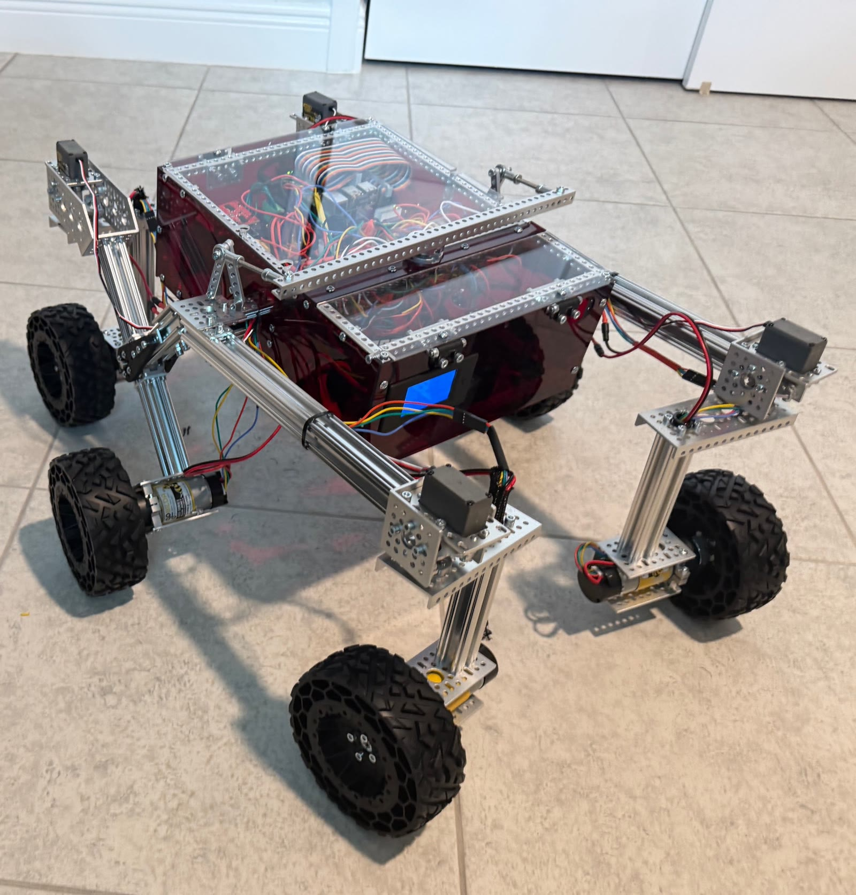

# KASANE ROVER PROJECT
> This is an offshoot of NASA's Open Source Rover Project that includes modifications to make the hardware come together better and to include upgrades down the line.
> Software for this build: [kasane-rover-code](https://github.com/elizaCelica/kasane-rover-code)

## Motivation
The original project is meant to be expanded upon, which this project will do. This project also includes some tweaks and fixes to the original project based on my experience in building it.

## Planned Changes
- Controllable arms.
- The ability to house smaller robots/rovers inside of the main one.
- Self-driving capabilities

## Completed Changes & Fixes
- **Cables:** extended the length of the cables that connect the motors and servos to the PCB. The original cables either just barely reached or didn't reach at all.
- **INA260 power monitor:** reflowed weak SCL/SDA/VCC joints; fixed an intermittent
  ground in its header socket; reflowed loose Vin+/Vin− socket joints on the motor board
- **Steering servos:** corrected swapped servo channels on J19 and recalibrated each corner's center
- **Drive motors:** identified two reversed motors (right front/back); compensated in software
  pending a RoboClaw configuration fix
- **Power:** switched to Zeee 4S 14.8V 5200 mAh LiPo packs (XT60, adapted to the board's XT30);
  balance charging only, after two packs were lost to over-discharge

## Current Status
**Operational as of October 2026.** Drives, steers, and starts automatically at boot,
controlled with a PS5 DualSense. Software: [kasane-rover-code](https://github.com/elizaCelica/kasane-rover-code)

## Timeline
- **July 2026:** original target for an operational rover
- **October 2026:** operational, with drive, steering, and boot auto-start working
- **Next:** controllable arms, then self-driving

## Lessons Learned (so far)
- Always balance-charge LiPo batteries and never run them below ~3.2 V per cell; over-discharged packs are unsafe to recharge
- Double-check each corner's servo channel before calibration, as it turns into a headache once you've lost track
- Ensure enough solder has been applied to each hand-soldered joint
- Test cable length before the screws go in

## Credits
This of course would not be possible without the original project, [NASA-JPL Open Source Rover](https://github.com/nasa-jpl/open-source-rover).
